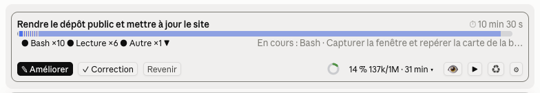
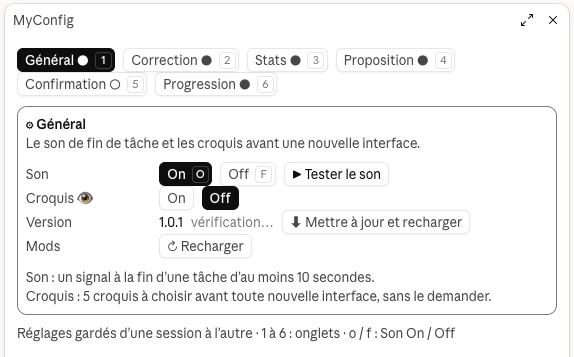
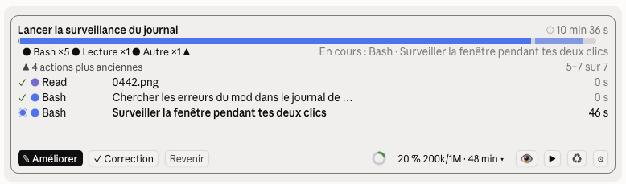

# MyConfig

Mod Claude Code qui réunit en un seul mod, réglables d'un même panneau, les mods
[jauge](../jauge), [fil-son](../fil-son), [relais](../relais), [plume](../plume) et
[cap](../cap), plus deux modules nouveaux, la Confirmation et la Progression. Une carte au-dessus du champ de saisie
réunit les boutons et les chiffres ; un panneau à onglets règle chaque module.



## Fonctions

| Module | Remplace | Ce qu'il fait | Réglages |
| --- | --- | --- | --- |
| **Son** | fil-son | Joue un son à la fin d'une tâche d'au moins 10 secondes. | On / Off |
| **Relais** | relais | Récapitule la conversation dans `.relais/`, l'efface et prépare le message de reprise. | Toujours là : bouton dans l'onglet Stats du panneau, ou `/relais` |
| **Correction** | plume | « ✎ Améliorer » reformule ta consigne en prompt structuré ; « ✓ Correction » corrige seulement le texte ; « Revenir » remet ton texte. | Afficher : Améliorer, Correction (aucun = Off) |
| **Stats** | jauge | Contexte utilisé (%, jetons) et durée de la session ; un clic ouvre les limites d'utilisation du forfait. Dans le panneau : le contenu du contexte, le coût, les limites et le Relais. | On / Off |
| **Proposition** | cap | Des suites logiques après chaque réponse ; un clic en lance une. | On / Off, 1 à 5, sur une ligne ou une par ligne ; modèle de la session |
| **Confirmation** | — | Claude résume ce qu'il compte faire et attend ton feu vert avant de créer ou de modifier quoi que ce soit. | On / Off, aussi d'un clic sur ⏸ / ▶ dans la bande |
| **Progression** | fil | L'avancement du travail : une barre fine et un point par étape de la liste de tâches de Claude ; sans liste, une piste de temps des actions. | Afficher : Avec liste, Sans liste (aucun = Off) ; disparaît après : instantané, 5 à 15 s, jamais ; détail : 3, 6, 9, 12, illimité |

### La bande

Au-dessus du champ de saisie, une carte arrondie (croquis 1, « Tableau de bord ») :

- Les propositions en haut, côte à côte ou une par ligne, puis une ligne vide avant les boutons.
- La Correction à gauche, puis à droite les Stats (un anneau de contexte dessiné dans l'app de
  bureau, un quart de disque au terminal), le bouton Confirmation et ⚙, qui ouvre le panneau.
- Le bouton Confirmation : « ⏸ » foncé quand la Confirmation est à On (Claude attend ton feu vert),
  « ▶ » normal à Off ; un clic bascule.
- Couleurs des Stats : vert sous 60 %, jaune de 60 à 79 %, rouge à 80 % et plus.
- Un clic sur les chiffres des Stats (▾) relit les données et ouvre, à la place des propositions,
  les **limites d'utilisation du forfait** : limite de 5 heures et limite hebdomadaire, chacune avec
  son %, le délai avant sa remise à zéro et une barre bleue. « ↻ » les relit ; un autre clic (▴)
  les ferme. Ce sont les chiffres que la dernière réponse a rapportés.
- Un module à Off disparaît de la bande ; le bouton Confirmation et ⚙ restent toujours.
- Le Relais n'est plus dans la bande, pour éviter un clic par erreur : son bouton est dans l'onglet
  Stats du panneau.

### Le panneau

⚙ ou `/myconfig` ouvre le panneau MyConfig (croquis 5, « Onglets ») : un onglet par module
(● On, ○ Off), son état On / Off et ses réglages propres.



- **Son** : bouton « ▶ Tester le son ».
- **Correction** : pas d'On / Off, mais « Afficher » : « ✎ Améliorer » et « ✓ Correction », chacun affiché
  ou non dans la bande ; aucun des deux, et la Correction est à Off. Le modèle est rappelé dessous.
- **Proposition** : le modèle (celui de la session : les propositions partent de la conversation en
  cache), nombre (1 à 5), disposition (« Sur une ligne », « Une par ligne »), « ↻ Proposer maintenant ».
- **Stats** (croquis C), en trois groupes :
  - **Cette session** : le contexte (% et jetons), une barre de son contenu (système, outils, MCP,
    mémoire, messages, libre, réserve du compactage) avec la légende, puis la durée et le coût en
    $ US au prix de l'API. Le contenu est l'estimation locale de `/context` : rien n'est envoyé au
    modèle.
  - **Forfait** : la limite de 5 heures et celle de la semaine, comme `/usage`, chacune avec sa barre
    bleue, son % et sa remise à zéro.
  - **Relais** : « ⇄ Relais » (« ⇄ Relais ! » à partir de 80 % de contexte). Deux clics : le premier
    affiche « Confirmer ? » pendant 6 secondes. Le bouton attend la fin du tour quand Claude
    travaille.
- **Confirmation** : l'état du dernier message (feu vert donné ou en attente).
- **Progression** : pas d'On / Off, mais « Afficher » : « ☰ Avec liste » et « ▬ Sans liste », chacun
  affiché ou non dans la bande ; aucun des deux, et la Progression est à Off. « Disparaît après »
  (Instantané, 5 s, 10 s, 15 s, Jamais), le temps où la barre reste après la fin ; à « Jamais », elle
  reste jusqu'à un clic sur son titre (✕). « Détail » (3, 6, 9, 12, Illimité), le nombre d'actions que
  le journal déplié montre. « ▶ Avec liste » montre 20 secondes une tâche de 7 étapes, « ▶ Sans liste » rejoue la piste de
  temps d'une publication (8 actions).

Au clavier, une fois le panneau sélectionné : `1` à `6` changent d'onglet, `o` et `f` mettent à On
ou à Off, `a` et `c` affichent ou retirent les boutons de la Correction, `a` et `s` les modes de la
Progression. Les réglages sont gardés d'une session à l'autre.

### La Progression

Deux modes, chacun affiché ou non dans l'onglet Progression du panneau (« Afficher ») ; un mode
retiré ne montre rien dans son cas, et l'autre ne prend pas sa place.

**Avec liste de tâches** : dès que Claude tient une liste (TodoWrite, TaskCreate, TaskUpdate), un bloc apparaît
en haut de la carte (variante 1, « barre fine et chapelet ») :

```
Migration des presets                                        50 % · ~4 min
━━━━━━━━━━━━━━━━━━━━━━━━━━━━━━━━━━━━━━━━━━━━━━━━━━━━━━━━━━━━━━━━━━━━━━━━━━
● ● ● ◉ ○ ○ ○   Étape 4 sur 7 · Valider
```

- Le titre est ta consigne ; à droite, le % (étapes faites, plus la moitié de celle en cours) et
  le temps restant estimé au rythme des étapes déjà faites.
- Le chapelet : ● étape faite, ◉ étape en cours, ○ étape restante.
- Une tâche finie passe au vert avec « ✓ 7 étapes · durée » et reste le temps choisi dans le
  panneau (« Disparaît après » : instantané, 5, 10 ou 15 secondes, 15 par défaut, ou jamais) ; un
  clic sur son titre ou sur ✕ l'efface ; une tâche interrompue disparaît aussitôt ; une liste inachevée en fin de tour reste « En pause » et
  reprend au tour suivant.
- Seul le fil principal compte : les listes des sous-agents sont ignorées.

**Sans liste de tâches** (croquis 3, « piste de temps »), dès que Claude agit (commande, lecture,
modification…), la piste suit ses actions :

```
Publie la version 0.3.0 de MyConfig                                ⏱ 1 min 12 s
███████▓▓▓▓▓▓▓▓▓▓▓▓▓████████████████████▓▓▓▓▓▓░░░░░░░░░░░░░░░░░░░░░░░░░░░░░
●  Bash ×3   ●  Lecture ×2   ●  Modif. ×1          En cours : Bash · Commit, push…
```

- Un segment par suite d'actions de même sorte, aussi long qu'elles ont duré : bleu pour les
  commandes, violet pour les lectures, vert pour les modifications, gris pour le reste.
- La piste se remplit de gauche à droite, de plus en plus lentement (la durée totale n'est pas
  connue d'avance), et atteint 100 % quand la tâche se termine : tout passe alors au vert, avec
  « ✓ 8 actions · durée ».
- Le chrono avance chaque seconde ; dessous, un point par sorte d'action avec son nombre, puis
  l'action en cours.
- Dès que Claude crée une liste de tâches, la barre des étapes prend le relais (si « Avec liste »
  est affiché).

**Le détail, d'un clic** (croquis 1, « journal déplié ») : un clic sur la ligne sous la barre (les
points et « ▼ ») déplie, dans la carte, les dernières actions de Claude (3, 6, 9, 12 ou toutes celles
qui tiennent dans la bande, au choix du panneau) ; un autre clic la replie. Dans le terminal, la
barre elle-même est cliquable ; dans l'app de bureau, la barre est une image et c'est la ligne
dessous qui prend le clic.



- Chaque action (Journal 1) : ✓ faite ou ◉ en cours, l'outil (point de la couleur de sa sorte), son
  titre en entier, sur plusieurs lignes au besoin (le fichier, la description de la commande, le
  motif), et sa durée. Quand de longs titres prennent plus de place, la page compte moins d'actions.
- Plus d'actions que de place : « ▲ N actions plus anciennes » remplace le trait au-dessus du
  journal, avec la position à droite (« 4–6 sur 12 ») ; un clic recule d'une page (autant d'actions
  que le « Détail »), et « ▼ N plus récentes », dessous, avance. La page reste en place quand de
  nouvelles actions arrivent ; replié puis rouvert, le journal revient aux dernières actions.
- Le journal garde les 200 dernières actions de la tâche ; il marche aussi avec une liste de tâches,
  sous le chapelet. Il reste déplié d'une tâche à l'autre, jusqu'au clic suivant.

### La Confirmation

Le bouton ⏸ / ▶ de la bande la met à On ou à Off ; remise à On, elle attend un nouveau feu vert.
À On, chaque message que tu envoies est lu :

- **Avec un feu vert** (« go », « vas-y », « tu peux y aller », « oui », « ok », « procède »,
  « c'est bon »…), Claude produit.
- **Sans feu vert**, ou s'il est repris aussitôt (« non », « attends », « pas encore »), Claude
  résume ce qu'il compte faire et demande s'il faut procéder. Les outils qui écrivent des
  fichiers (Write, Edit, NotebookEdit) sont refusés tant que le feu vert manque.

La règle passe par une section de la consigne système et par une note jointe à chacun de tes
messages. Une commande Bash qui modifie quelque chose n'est pas bloquée par le mod : seule la
consigne la retient.

### Commandes

```
/myconfig                          ouvre le panneau
/myconfig etat                     résume les réglages et les stats
/myconfig <module> on | off        son, correction, stats, proposition, confirmation, progression
/myconfig proposition 1 à 5        nombre de propositions
/myconfig proposition ligne | liste
/myconfig ameliorer | corriger on | off   affiche ou retire un bouton de la Correction
/myconfig progression avec | sans on | off   affiche ou retire un mode de la Progression
/myconfig progression disparait 0 | 5 | 10 | 15 | jamais   secondes où la barre reste après la fin
/myconfig progression detail 3 | 6 | 9 | 12 | illimite    actions du journal déplié
/relais [léger | dernier | purger [n]]
/correction <texte> | corriger <texte> | retour
```

Les anciens noms sont compris aussi : `/myconfig jauge off`, `/myconfig plume on`, `/myconfig cap 4`.

Le modèle de la Correction (sonnet, haiku ou opus) se règle dans les options du plugin.

## Installer

MyConfig s'installe depuis le marketplace local « plugins-dany » : le dossier
`~/Developer/Plugins`, qui regroupe tous les mods de Dany.

```bash
claude plugin marketplace add ~/Developer/Plugins
```

```bash
claude plugin install myconfig@plugins-dany
```

Le plugin est lu directement dans `~/Developer/Plugins/myconfig` : après une modification,
`/reload-plugins` dans une session suffit, sans réinstaller.

Ne pas activer MyConfig en même temps que jauge, fil, fil-son, relais, plume ou cap : boutons et son
seraient en double (`claude plugin disable <mod>@plugins-dany` les désactive).

Testé avec Claude Code 2.1.295.

## Tests

```bash
claude plugin validate .
```

```bash
claude plugin test .
```

Les tests demandent Claude Code 2.1.295 ou plus récent. Ils simulent la session (contexte,
limites du forfait, horloge, modèle, champ de saisie) et dessinent la bande et le panneau au
terminal et dans l'app de bureau ; ils ne jouent aucun son et n'écrivent aucun fichier.

## Organisation

- `.claude-plugin/plugin.json` : manifeste du mod
- `hooks/hooks.json` : nomme le module de hooks
- `hooks/register.tsx` : tous les hooks, la bande et le panneau (tout ce qui touche au moteur)
- `hooks/reglages.ts` : réglages par défaut, commande `/myconfig` (pur)
- `hooks/stats.ts`, `hooks/progression.ts`, `hooks/proposition.ts`, `hooks/correction.ts`, `hooks/confirmation.ts`,
  `hooks/son.ts`, `hooks/relais-consigne.ts`, `hooks/relais-outils.ts` : fonctions pures des modules
- `types/index.d.ts` : contrat des valeurs de `$.state`
- `sons/fin.aiff` : signal de fin
- `tests/` : tests du mod
- `docs/` : captures d'écran (`capture.png` la bande, `panneau.png` le panneau, `journal.png` le journal déplié)
